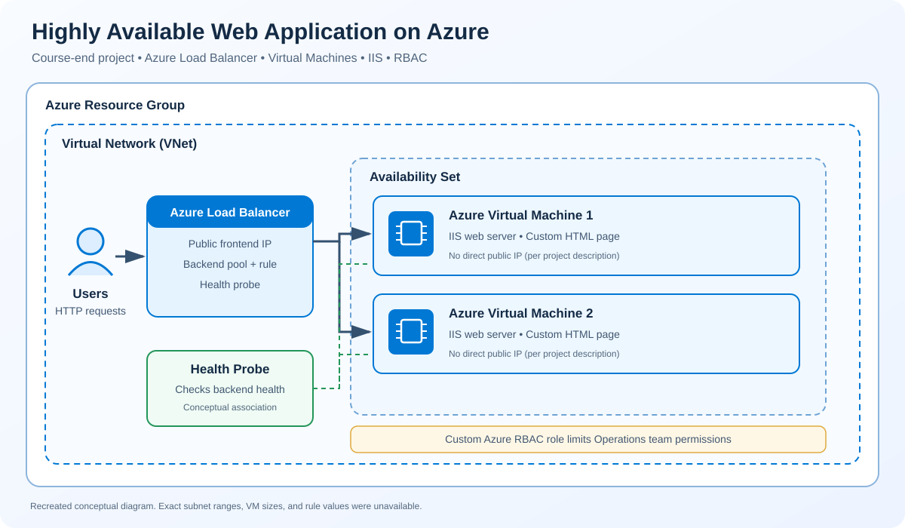

# Highly Available Web Application on Azure Load Balancer

A course-end cloud project exploring how Azure Load Balancer can distribute incoming web traffic across two Azure Virtual Machines and route requests only to healthy backend instances.

## Project goals

- Deploy two Azure Virtual Machines in an Availability Set within a Virtual Network and Resource Group.
- Use an Azure public Load Balancer to distribute incoming HTTP traffic to the VM backend pool.
- Configure a health probe so the load balancer can check backend availability.
- Host custom HTML pages on IIS on both virtual machines.
- Reduce direct exposure by removing public IP addresses from the VMs and directing user traffic through the Load Balancer.
- Apply least privilege with a custom Azure RBAC role for the Operations team.

## Architecture



## Request flow

1. A user sends an HTTP request to the public frontend IP of the Azure Load Balancer.
2. The Load Balancer uses its configured rules and backend pool to forward traffic to a VM.
3. The health probe checks backend availability.
4. IIS on the VM serves its custom HTML page.
5. The network design directs user-facing traffic through the Load Balancer rather than directly to VM public IPs.

## Services and technologies

| Service | Purpose |
|---|---|
| Azure Virtual Network (VNet) | Provides network connectivity for project resources |
| Azure Virtual Machines | Hosts the two IIS web servers |
| Availability Set | Groups the VMs to improve resilience to planned/unplanned maintenance events |
| Azure Load Balancer | Provides a public frontend and distributes traffic to the backend pool |
| Health Probe | Checks backend availability for load-balancing decisions |
| IIS | Serves the custom HTML pages |
| Network security rules | Restricts network traffic and reduces direct VM exposure |
| Azure RBAC | Custom role limits the Operations team's access to required resources |

## Implementation highlights

- Created two VMs in an Availability Set within one VNet and Resource Group.
- Configured the Azure public Load Balancer frontend IP, backend pool, and health probe.
- Installed IIS and hosted a custom HTML page on each VM.
- Removed public IP addresses from the VMs and directed user traffic through the Load Balancer using network rules.
- Created a custom Azure RBAC role to limit the Operations team's permissions to the required resources.
- Tested the website through the Load Balancer and checked that traffic reached both servers.

## Validation and limitations

The project description reports that the website was tested through the Load Balancer and traffic reached both servers. Original screenshots, configuration exports, and logs are not available, so the results cannot be independently reproduced from saved evidence here.

This repository contains documentation and a recreated diagram only. It does not contain deployable Terraform/Bicep templates or the original VM configuration. Exact subnet CIDRs, VM sizes, region, Load Balancer SKU, and detailed rule values are not included because the original configuration is unavailable.

## Key learnings

- How a public Load Balancer, frontend IP, backend pool, and health probe work together.
- How to host IIS content on Azure VMs.
- Why VMs should not need direct public IP exposure when traffic can be routed through a load-balancing frontend.
- How Azure RBAC can apply least-privilege access to operational teams.
- Why health checks and validating traffic distribution matter when testing high-availability designs.

## Repository structure

```text
.
├── README.md
├── images/
│   └── architecture.svg
└── docs/
    └── project-notes.md
```
**Focus:** Azure networking, load balancing, virtual machines, IIS, health probes, and RBAC
